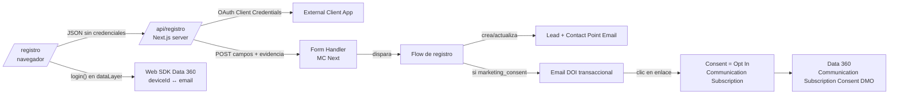

# Registro con doble opt-in (Marketing Cloud Next)

La página `/registro` crea la cuenta del cliente y, si marca la casilla de comunicaciones, dispara un doble opt-in desde Marketing Cloud Next.

## Flujo

Clave que viaja en cada salto: el **email** (Contact Point Email) es la clave común entre la web, el Lead de MC Next y el perfil de Data 360. El `customerId` `ALT-…` que genera `lib/auth.ts` se envía al Web SDK en el login; si se quiere usar también como regla de Identity Resolution, añadirlo como campo del Form Handler.

## Piezas en Salesforce

1. **External Client App** con OAuth, *Client Credentials Flow* habilitado y un usuario de integración como *Run As* con permisos mínimos (solo lo que necesita el Form Handler). Client ID y secret van a `SF_CLIENT_ID` / `SF_CLIENT_SECRET` en Vercel.
2. **CORS allowlist** con el origen del sitio (`NEXT_PUBLIC_SITE_URL`). El handler de Next.js envía las cabeceras `Origin` y `Referer` con ese dominio; el Form Handler rechaza con 403/404 si no están en la allowlist.
3. **Form Handler** (Marketing → Form Handlers) con estos campos, que son los que envía `lib/mcNext.ts` (`toFormHandlerFields`):
   `first_name`, `last_name`, `email`, `phone`, `company` (siempre "Particular", Lead lo exige), `status` ("Open - Not Contacted" o `MC_LEAD_STATUS`), `marketing_consent`, `privacy_accepted`, `consent_source`, `consent_captured_at`, `consent_ip`, `consent_user_agent`.
   Submission Redirect URL: `https://<sitio>/registro`. Copiar la URL de envío del handler a `MC_FORM_HANDLER_URL`.
4. **Flow asociado al Form Handler**:
   1. Crear o actualizar el Lead por email (Get Records + Decision para no duplicar).
   2. Guardar la evidencia (`consent_source`, `consent_captured_at`, `consent_ip`) en el Lead o en un objeto de log.
   3. Decision `marketing_consent = true`:
      - Enviar el **email de DOI clasificado como transaccional** (sin Communication Subscription), con el botón de confirmación.
      - Esperar el clic en el enlace de confirmación (con un timeout, p. ej. 7 días).
      - Al hacer clic: **Update Consent → Opt In** para la Communication Subscription "Newsletter Altamar", contact point = email del formulario. Redirigir el enlace a `https://<sitio>/registro/confirmado`.
      - Si vence el timeout: no hacer nada. Sin registro de consentimiento, MC Next trata el contacto como Opt Out.
   4. Si `marketing_consent = false`: solo el Lead, sin email comercial.
5. **Email de bienvenida + 10 %**: enviarlo después del Opt In (ya como comercial, con la Communication Subscription), no en el email de DOI.

## Por qué así

- **Server-side**: Salesforce recomienda no llamar al Form Handler desde el navegador; así el token y el secret no salen del servidor.
- **Opt In solo tras el clic**: marcar Opt In al enviar el formulario no es doble opt-in. Hasta el clic el contacto no tiene consentimiento y no entra en envíos comerciales.
- **Evidencia**: fecha, origen, IP y user agent del alta, más la fecha del clic, sirven de prueba ante una reclamación RGPD.
- **Data 360**: MC Next guarda el consentimiento en el modelo de Data 360 (Communication Subscription Consent), así que segmentos y activaciones lo respetan sin integraciones extra.

## Pendiente de confirmar en la org

- La URL exacta de envío y el formato del cuerpo que espera el Form Handler: no se pudieron contrastar con la guía oficial desde aquí. Si el handler espera otro formato, solo cambia `submitToFormHandler` en `lib/mcNext.ts`.
- El paso exacto del Flow para esperar el clic del email de DOI en la release actual.
- `components/Newsletter.tsx` sigue enviando `newsletterOptIn: "1"` al Web SDK sin confirmación; conviene llevarlo al mismo `/api/registro` (o a un Form Handler propio) para que también pase por el DOI.
