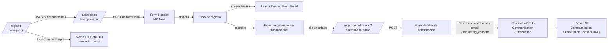

# Registro con doble opt-in (Marketing Cloud Next)

La página `/registro` crea la cuenta del cliente y, si marca la casilla de comunicaciones, dispara un doble opt-in desde Marketing Cloud Next.

## Flujo

Clave que viaja en cada salto: el **email** (Contact Point Email) es la clave común entre la web, el Lead de MC Next y el perfil de Data 360. El `customerId` `ALT-…` que genera `lib/auth.ts` se envía al Web SDK en el login; si se quiere usar también como regla de Identity Resolution, añadirlo como campo del Form Handler.

## Piezas en Salesforce

1. **Envío server-side sin OAuth**: el Form Handler ofrece en *Code Snippet → Server-side* una URL pública de envío (`https://<sitio>.my.site.com/lp/cms/form/submit/v1/<FORM_ID>`). `/api/registro` hace un POST de formulario (`application/x-www-form-urlencoded`) a esa URL, que va en `MC_FORM_HANDLER_URL`. No hace falta External Client App.
   El endpoint sí valida `Origin` y `Referer` contra la **CORS allowlist** (Setup → CORS): hay que añadir el dominio de la web (preview y producción). `/api/registro` envía ambas cabeceras con el dominio desde el que se usó el formulario.
2. **Failure Page URL** distinta de la de éxito (p. ej. `/registro?error=1`): el handler responde con una redirección y `/api/registro` la usa para saber si el envío falló.
3. **Form Handler** (Marketing → Form Handlers) con estos campos, que son los que envía `lib/mcNext.ts` (`toFormHandlerFields`):
   `first_name`, `last_name`, `email`, `phone`, `company` (siempre "Particular", Lead lo exige), `status` ("Open - Not Contacted" o `MC_LEAD_STATUS`), `marketing_consent` (checkbox `Marketing_Consent__c` en Lead).
   La evidencia del alta (fecha, origen, IP, user agent) queda de momento en los logs del servidor; si se crean campos en Lead para guardarla, se añaden en `toFormHandlerFields`.
   Submission Redirect URL: `https://<sitio>/registro`. Copiar la URL de envío del handler a `MC_FORM_HANDLER_URL`.
4. **Flow asociado al Form Handler**:
   1. Crear o actualizar el Lead por email (Get Records + Decision para no duplicar).
   2. Guardar la evidencia (`consent_source`, `consent_captured_at`, `consent_ip`) en el Lead o en un objeto de log.
   3. Enviar **siempre** el **email de confirmación, clasificado como transaccional** (sin Communication Subscription), con el botón de confirmación. Confirma la cuenta (que el email es suyo); no depende de `marketing_consent`, porque alguien puede registrarse solo para comprar.
      - El botón del email enlaza a `https://<sitio>/registro/confirmado?e={{$individual.email}}&l={{$recipient.Id}}`. En este email `{{$recipient.Id}}` llega vacío, así que la página toma el Id del Lead del `individualId` del `sftoken` que MC Next añade al enlace.
      - No se usa "Wait Until Event → Email Link Click": los enlaces de un email hecho en HTML no registran clics (0 % en Analytics), así que el Flow se quedaba esperando.
5. **Form Handler "Altamar Confirmación DOI"** (data source Lead, campos `email`, `lead_id` → External ID, `last_name` y `status` porque son obligatorios). `/registro/confirmado` lo llama desde `/api/registro/confirmar` con `MC_CONFIRM_FORM_HANDLER_URL`. Su Flow:
   1. Get Records Lead donde Id = `lead_id` **y** Email = `email` (sin coincidencia de ambos no hay Opt In, así nadie confirma por otro).
   2. Si hay Lead → **Update Records**: `Email_Confirmado__c` = true (checkbox en Lead; deja constancia de la cuenta confirmada aunque no haya consentimiento).
   3. Decision: si hay Lead **y** `Marketing_Consent__c` = true → **Create Consent → Opt In**, Email, "Newsletter Altamar", contact point = email del Lead. Si hay Lead sin consentimiento, la cuenta queda confirmada y no se crea Opt In.
   No crea Leads; solo marca `Email_Confirmado__c`.
6. **Email de bienvenida + 10 %**: enviarlo después del Opt In (ya como comercial, con la Communication Subscription), no en el email de DOI.

## Por qué así

- **Server-side**: la web valida y filtra bots antes de enviar, y el envío no depende de JavaScript en el navegador. La web ya tiene su propio tracking de Data 360, así que no se pierde nada respecto al método client-side.
- **Opt In solo tras el clic**: marcar Opt In al enviar el formulario no es doble opt-in. Hasta el clic el contacto no tiene consentimiento y no entra en envíos comerciales.
- **Evidencia**: fecha, origen, IP y user agent del alta, más la fecha del clic, sirven de prueba ante una reclamación RGPD.
- **Data 360**: MC Next guarda el consentimiento en el modelo de Data 360 (Communication Subscription Consent), así que segmentos y activaciones lo respetan sin integraciones extra.

## Pendiente de confirmar en la org

- La URL exacta de envío y el formato del cuerpo que espera el Form Handler: no se pudieron contrastar con la guía oficial desde aquí. Si el handler espera otro formato, solo cambia `submitToFormHandler` en `lib/mcNext.ts`.
- El paso exacto del Flow para esperar el clic del email de DOI en la release actual.
- `components/Newsletter.tsx` sigue enviando `newsletterOptIn: "1"` al Web SDK sin confirmación; conviene llevarlo al mismo `/api/registro` (o a un Form Handler propio) para que también pase por el DOI.
